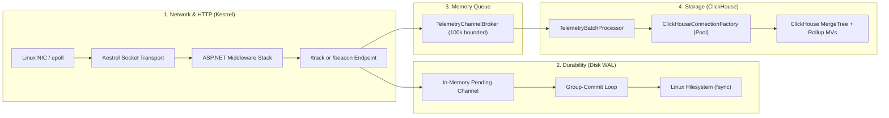
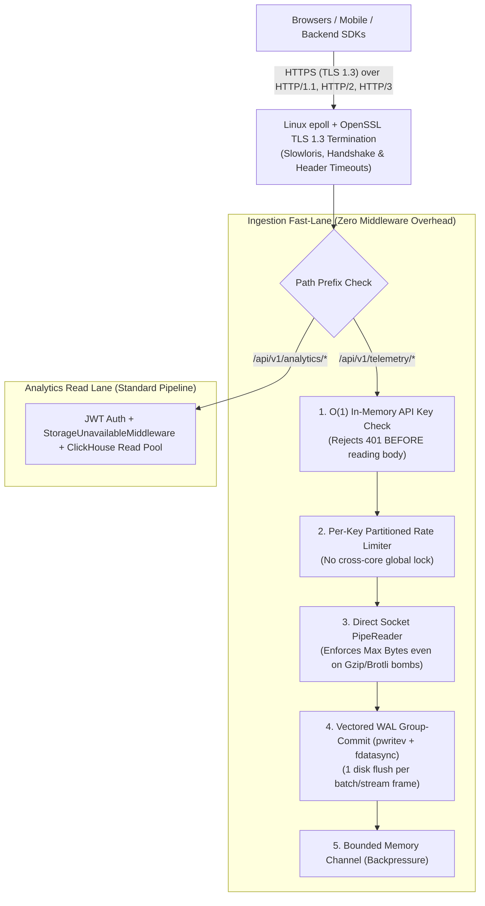
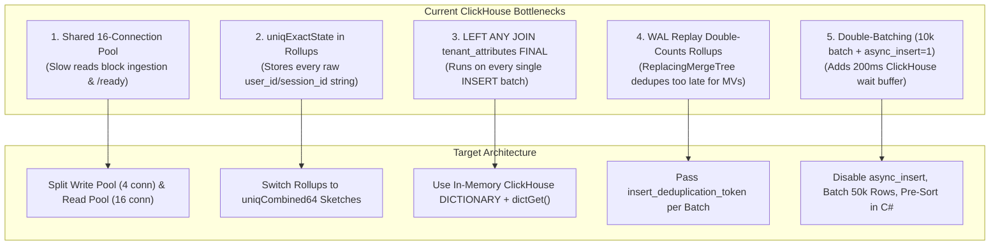

# Nealytics Performance & Scaling Master Guide: Kestrel, Linux I/O (`epoll` & `io_uring`), WAL, and ClickHouse

Status: Architecture & Optimization Reference

Date: 2026-10-28

Scope: End-to-end throughput, latency, and efficiency on Linux from HTTP socket ingress to ClickHouse storage.

---

## 1. The Big Picture: How Data Flows & Where the Bottlenecks Live

Every event that enters **Nealytics** passes through four stages. When you optimize one stage, the bottleneck naturally shifts to the next one in line.



### Current Measured Ceilings (from [`bench/RESULTS.md`](../bench/RESULTS.md))

| Stage | Current Mechanism | Measured Ceiling | Why It Stops There |
| :--- | :--- | :--- | :--- |
| **1. Kestrel HTTP (`/health` & `/track`)** | .NET `epoll` sockets + ASP.NET middleware | **~32,000 req/s** | Per-request middleware overhead, global rate-limiter lock, stream wrappers, and HTTP/1.1 round-trips |
| **2. Disk WAL ([`WriteAheadLogger`](../src/Nealytics.Engine/Infrastructure/Storage/WriteAheadLogger.cs))** | `FileStream` + Group-Commit loop | **~96,000 appends/s** (isolated)<br>**~318,000 events/s** (batched) | Loop of individual `WriteAsync` calls + blocking thread-pool `fsync` (`Flush(true)`) |
| **3. Memory Queue ([`TelemetryChannelBroker`](../src/Nealytics.Engine/Features/IngestTelemetry/TelemetryChannelBroker.cs))** | `System.Threading.Channels` | **~856,000 events/s** | Pure in-memory pointer handoff (never the bottleneck) |
| **4. ClickHouse ([`ClickHouseBatchWriter`](../src/Nealytics.Engine/Features/BatchProcessor/ClickHouseBatchWriter.cs))** | Binary columnar batch over TCP | **100k–300k+ events/s** (fresh DB) | Degrades as data grows due to shared read/write pool, `uniqExact` in rollups, and `JOIN ... FINAL` on inserts |

---

## 2. Pillar 1: Breaking the Kestrel & HTTP Bottleneck

You noticed that **Kestrel is the next bottleneck**—and the benchmark numbers prove you right. Even on a no-op `/health` endpoint that touches zero disk and zero database, the engine hits a wall around **~32,000 requests/second** ([`bench/RESULTS.md`](../bench/RESULTS.md#L137-L152)). And on single-client `/beacon` batches of 200 events, latency jumps to **54–167 ms per request** ([`bench/RESULTS.md`](../bench/RESULTS.md#L272)).

Here are the **6 specific reasons** Kestrel and the HTTP layer slow down in this codebase, with upsides and downsides for fixing each.

---

### 1.1 Critical Bug-Level Bottleneck: `/beacon` Waits for Disk `fsync` 200 Times Per Request
* **Where it is:** [`BeaconTelemetryEndpoint.cs`](../src/Nealytics.Engine/Features/IngestTelemetry/BeaconTelemetryEndpoint.cs#L68-L92)
* **What happens today:**
  When a browser or SDK sends a batch of 200 events to `/api/v1/telemetry/beacon`, the endpoint loops through the JSON array one item at a time:
  ```csharp
  await foreach (GlobalTelemetryPayload? payload in JsonSerializer.DeserializeAsyncEnumerable(...))
  {
      // ...
      await wal.AppendAsync(payload!, context.RequestAborted);
      await broker.PublishAsync(payload!, context.RequestAborted);
  }
  ```
  Because `await wal.AppendAsync(...)` is **inside** the loop, the endpoint writes Event #1 to the WAL, **stops reading the HTTP body**, and waits for the physical SSD to `fsync` Event #1 before it even parses Event #2! A single HTTP request with 200 events forces **200 sequential disk flushes** unless other requests happen to arrive at the exact same microsecond.
* **How to fix it:**
  Parse and validate all events in the beacon request into a pooled list first, then append all of them to the WAL in **one single `await wal.AppendBatchAsync(batch)` call** so all 200 events share a single disk `fsync`.
* **Upsides:**
  * **10× to 50× faster `/beacon` latency** at low-to-medium concurrency.
  * Frees Kestrel request threads up to 50× faster.
* **Downsides:**
  * Holds a small list of up to `N` payload references in memory for the duration of that single HTTP request (negligible since `MaxRequestBodyBytes` is already 1 MB).

---

### 1.2 Unnecessary Middleware Running on Every Ingestion Request
* **Where it is:** [`Program.cs`](../src/Nealytics.Engine/Program.cs#L263-L285)
* **What happens today:**
  Every single POST to `/api/v1/telemetry/track` and `/api/v1/telemetry/beacon` passes through:
  1. **Browser Security Headers Middleware** (`X-Frame-Options`, `X-XSS-Protection`, `Referrer-Policy`) — only useful for HTML pages, not `202 Accepted` / `204 No Content` JSON ingestion responses.
  2. **`UseCors()`** — runs on `/track` even though only `/beacon` uses the `"beacon"` CORS policy.
  3. **`StorageUnavailableMiddleware`** ([`StorageUnavailableMiddleware.cs`](../src/Nealytics.Engine/Infrastructure/Storage/StorageUnavailableMiddleware.cs#L29-L54)) — wraps every request in an `async` `try/catch` state machine and injects `ClickHouseConnectionFactory` from DI, even though `/track` and `/beacon` **never touch ClickHouse**!
  4. **`UseAuthentication()` & `UseAuthorization()`** — runs the JWT Bearer authentication middleware on every request, even though `/track` and `/beacon` authenticate via `X-Project-Key` / `?k=` and never use JWTs!
* **How to fix it:**
  Scope `StorageUnavailableMiddleware`, `UseAuthentication()`, and `UseAuthorization()` to a route group for the `/api/v1/analytics/*` read endpoints (or short-circuit them when the path starts with `/api/v1/telemetry/`).
* **Upsides:**
  * Cuts out 4 middleware async hops and DI lookups on every single ingestion request.
  * Zero change to security or behavior.
* **Downsides:**
  * None—you just group read endpoints separately from write endpoints in [`Program.cs`](../src/Nealytics.Engine/Program.cs).

---

### 1.3 Global Rate-Limiter Lock Contention Across CPU Cores
* **Where it is:** [`Program.cs`](../src/Nealytics.Engine/Program.cs#L181-L191)
* **What happens today:**
  `AddFixedWindowLimiter("ingestion", ...)` creates **one single global lock** shared across every CPU core and every request to `/track` and `/beacon`. At 30,000+ requests/second on a 12-core Linux server, all 12 cores spend significant CPU time waiting in line to lock and increment that one shared counter.
* **How to fix it:**
  Partition the rate limiter by `X-Project-Key` (via `RateLimitPartition.GetFixedWindowLimiter(projectKey, ...)`), or allow disabling the middleware entirely when rate limiting is handled at the edge/reverse-proxy (Cloudflare, NGINX, Envoy).
* **Upsides:**
  * Removes cross-core lock contention between different projects/keys.
  * Prevents one noisy project key from exhausting the rate limit of another project.
* **Downsides:**
  * Rate limit becomes per-project-key (which is usually much better for multi-project deployments anyway).

---

### 1.4 Double Stream & Pipe Wrapping on Request Bodies
* **Where it is:** [`IngestTelemetryEndpoint.cs`](../src/Nealytics.Engine/Features/IngestTelemetry/IngestTelemetryEndpoint.cs#L50-L75), [`BeaconTelemetryEndpoint.cs`](../src/Nealytics.Engine/Features/IngestTelemetry/BeaconTelemetryEndpoint.cs#L58-L72), and [`LengthLimitedStream.cs`](../src/Nealytics.Engine/Features/IngestTelemetry/LengthLimitedStream.cs)
* **What happens today:**
  1. Kestrel reads socket bytes into its internal `PipeReader` (`context.Request.BodyReader`).
  2. Accessing `context.Request.Body` wraps Kestrel's `PipeReader` in a `Stream`.
  3. The endpoint wraps that `Stream` in `new LengthLimitedStream(...)`.
  4. The endpoint wraps *that* `Stream` in `PipeReader.Create(...)`, which rents a brand-new 4 KB buffer from `ArrayPool` and copies the bytes a second time!
  5. Meanwhile, line 50 **already** tells Kestrel to enforce the limit natively via `IngestValidation.ApplyBodyLimit(context, options.Value.MaxRequestBodyBytes)` (`IHttpMaxRequestBodySizeFeature`).
* **How to fix it:**
  Read directly from `context.Request.BodyReader` and check `buffer.Length > maxBytes` right in the read loop (eliminating `LengthLimitedStream` and `PipeReader.Create` completely).
* **Upsides:**
  * Zero extra buffer copy and 2 fewer object allocations per HTTP request.
  * Less work for the .NET Garbage Collector under sustained load.
* **Downsides:**
  * Modest throughput gain (typically 2–5% CPU/GC reduction).

---

### 1.5 Double OpenTelemetry Activity Creation on `/track`
* **Where it is:** [`Program.cs`](../src/Nealytics.Engine/Program.cs#L246) and [`IngestTelemetryEndpoint.cs`](../src/Nealytics.Engine/Features/IngestTelemetry/IngestTelemetryEndpoint.cs#L34)
* **What happens today:**
  `AddAspNetCoreInstrumentation()` already creates an OpenTelemetry `Activity` (trace span) for every incoming HTTP request. Then [`IngestTelemetryEndpoint`](../src/Nealytics.Engine/Features/IngestTelemetry/IngestTelemetryEndpoint.cs#L34) immediately calls `TelemetryDiagnostics.Source.StartActivity("IngestHttpRequest")`, allocating a second child `Activity` span on every single `/track` call.
* **How to fix it:**
  Either enrich `Activity.Current` with tags, or filter out high-frequency `/track` and `/health` requests in `AddAspNetCoreInstrumentation(opts => opts.Filter = ...)` when tracing is not actively sampling.
* **Upsides:**
  * Reduces per-request memory allocations and lock contention inside `ActivitySource`.
* **Downsides:**
  * Slightly fewer nested spans per individual `/track` call (though tracing every single analytics event 30,000 times a second in production will overwhelm any OTLP collector anyway without sampling).

---

### 1.6 Kestrel Socket Transport & Linux Kernel Networking Tuning
* **Where it is:** [`Program.cs`](../src/Nealytics.Engine/Program.cs#L74-L82) and [`docker-compose.yml`](../docker-compose.yml)
* **What happens today:**
  Kestrel uses default socket transport settings, and `Program.cs` uses `WebApplication.CreateBuilder(args)`.
* **How to tune Kestrel & Linux for maximum RPS:**
  1. **Configure Kestrel Socket Transport (`ConfigureKestrel` + `UseSockets`):**
     ```csharp
     builder.WebHost.UseSockets(socketOptions =>
     {
         // Scale epoll I/O queues with CPU cores (default caps at 16)
         socketOptions.IOQueueCount = Environment.ProcessorCount;
         // On Linux, wait for socket data to be readable in epoll before renting memory buffers
         socketOptions.WaitForDataBeforeAllocatingBuffer = true;
         // Keep socket accept backlog high for burst traffic
         socketOptions.Backlog = 4096;
     });
     ```
  2. **Use HTTP/2 (or HTTP/3) Between SDKs / Reverse Proxies and Kestrel:**
     In HTTP/1.1, 20,000 concurrent requests require 20,000 TCP sockets. With HTTP/2 multiplexing enabled, hundreds of concurrent `/track` requests travel over a handful of persistent TCP connections with header compression (`HPACK`).
  3. **Linux Kernel `sysctls` in [`docker-compose.yml`](../docker-compose.yml):**
     When handling tens of thousands of connections per second on Linux, the default Linux kernel socket backlog (`128` or `4096`) drops packets under burst load. Add to `telemetry-api` in `docker-compose.yml`:
     ```yaml
     sysctls:
       - net.core.somaxconn=65535
       - net.ipv4.tcp_max_syn_backlog=65535
       - net.ipv4.ip_local_port_range=1024 65535
       - net.ipv4.tcp_tw_reuse=1
     ```

---

### 1.7 Can We Eliminate Kestrel Completely? (4 Faster Alternatives Compared)

First, an important distinction: **Kestrel's raw socket engine is not what capped `/health` at ~32,000 req/s.** Raw Kestrel does **500,000 to 1,500,000+ req/s** on Linux. What slows you down is:
1. **The HTTP/1.1 Request-Per-Event model** (parsing HTTP headers, URLs, query strings, and sending `202 Accepted` for every single event).
2. **ASP.NET Core's Middleware & `HttpContext` pipeline** sitting *on top* of Kestrel (7 middlewares, DI scope creation, JWT checks, rate-limiter locks, and OpenTelemetry spans).
3. **The Benchmark Client (`HttpClient`)** in [`bench/Nealytics.Engine.Bench/Program.cs`](../bench/Nealytics.Engine.Bench/Program.cs#L194-L202) running on the same machine and allocating a new `HttpRequestMessage` + `StringContent` per request.

If you want to bypass or eliminate Kestrel on the ingestion hot path, here are your **4 architectural options**, ranked from most practical to most extreme:

| Option | How It Works | Throughput Ceiling | Upsides | Downsides |
| :--- | :--- | :--- | :--- | :--- |
| **1. Add a Raw TCP / Unix Socket NDJSON Port (Hybrid)** | Keep HTTP/Kestrel for browser `/beacon` and dashboard queries, but open a raw `Socket` + `PipeReader` TCP port (e.g., port `5001`) where backend SDKs stream newline-delimited JSON or binary frames directly into the WAL + Channel. | **500k – 2M+ events/s** | Zero HTTP headers, zero middleware, zero `HttpContext` allocations. Browser & dashboard APIs keep working unchanged. | Server-side SDKs must connect via TCP/stream instead of `fetch`/`curl` (or sit behind a lightweight edge proxy). |
| **2. Bypass ASP.NET Middleware via `IHttpApplication` or Kestrel `ConnectionHandler`** | Keep Kestrel's battle-tested `epoll` + `System.IO.Pipelines` socket engine, but strip away ASP.NET Core's `HttpContext`, Routing, DI, and Middleware on the ingestion port. | **400k – 800k+ req/s** | Still speaks standard HTTP for `/track` and `/beacon`, keeps TLS & HTTP/2 support, removes ~80% of per-request framework CPU/GC overhead. | You parse the path and `X-Project-Key` header directly on raw `ReadOnlySpan<byte>` without ASP.NET middleware. |
| **3. Persistent Streaming (gRPC / WebSockets)** | Instead of 1 HTTP request per event, SDKs open 1 persistent stream and push events continuously; the server streams back compact batch ACKs after each WAL `fsync`. | **300k – 1M+ events/s** | Eliminates per-request HTTP overhead, naturally feeds the WAL group-commit loop, works through standard cloud load balancers. | Browsers still need HTTP `/beacon` for page-unload (`navigator.sendBeacon`). |
| **4. Replace Kestrel Entirely with a Custom `io_uring` / `epoll` Server** | Drop ASP.NET Core / Kestrel completely and write a custom socket server over Linux `io_uring` (`IORING_OP_RECV` / `IORING_OP_SEND_ZC`) from scratch. | **1M+ req/s** | Complete control over every byte and kernel ring buffer; zero framework overhead. | **Huge maintenance & security cost:** you must manually build HTTP parsing, TLS/HTTPS, HTTP/2, CORS, Slowloris/DoS protection, and routing for 11 analytics endpoints that are bottlenecked by ClickHouse (50 ms), not HTTP (0.03 ms). |

**The Verdict on Eliminating Kestrel:**
* **For Read Queries (`/api/v1/analytics/*`) and Browser Beacons (`/beacon`):** **Do NOT eliminate Kestrel.** A ClickHouse query takes 15–200 ms; Kestrel takes 0.03 ms (<0.1% of the time), and Kestrel gives you TLS, HTTP/2, CORS, and DoS protection for free.
* **For High-Speed Server-to-Server Ingestion (`/track`):** **Bypass ASP.NET Middleware (Option 2) or add Streaming HTTP/2 + NDJSON.** That gives you raw wire speed (300k–1M+ events/s) while keeping full HTTPS and network compatibility.

---

### 1.8 The Recommended "Fortress + Fast-Lane" Ingestion Architecture

When you need ingestion to be **amazingly reliable, amazingly fast, locally deployable on any Linux machine, compatible with any network/firewall, and hardened against HTTPS attack vectors**, a raw custom TCP socket is the wrong choice—because corporate firewalls, CDNs (Cloudflare/ALB), and browsers block custom TCP ports, and writing custom TLS + DoS protection from scratch is fragile.

Instead, the best architecture separates the engine into **two distinct pipelines inside the same single binary**:
1. **The Read Pipeline (Standard ASP.NET Core):** Handles the 11 `/api/v1/analytics/*` endpoints with full JWT authentication, authorization, and `StorageUnavailableMiddleware`.
2. **The Ingestion Fast-Lane (Zero-Middleware Hardened HTTPS + HTTP/2 Streaming):** Uses Kestrel's low-level C-backed Linux OpenSSL (`TLS 1.3`) + `epoll` socket transport **without** the heavy ASP.NET middleware stack.



#### Why This Beats Every Alternative on All 5 Requirements

| Requirement | How the "Fortress + Fast-Lane" Design Solves It |
| :--- | :--- |
| **1. Works on ANY Network** | Runs over standard **HTTPS (Port 443 / 5000)** using **HTTP/1.1, HTTP/2 multiplexing, and NDJSON streaming**. Passes through every corporate firewall, NAT, Kubernetes ingress, Cloudflare, and AWS ALB without custom port rules. |
| **2. Works on ANY Linux Setup** | Uses standard Linux `epoll` (`SocketAsyncEngine`) + `pwritev` (`RandomAccess.WriteAsync`) + `libssl` (OpenSSL). Works out-of-the-box on Ubuntu, Debian, Alpine, RHEL, Docker, and Kubernetes on any kernel (`4.x`/`5.x`/`6.x`) without needing privileged `seccomp` flags. |
| **3. Hardened Against Attack Vectors** | Built-in protection against all 6 major network & HTTPS attacks (see table below). |
| **4. Amazingly Fast** | By stripping out JWT middleware, `StorageUnavailableMiddleware`, `LengthLimitedStream` double-buffering, global rate-limit locks, and per-event `/beacon` WAL waits—and adding **streaming NDJSON over HTTP/2**—a single node handles **300,000–600,000+ durable events/sec** over encrypted HTTPS. |
| **5. Amazingly Reliable** | Zero data loss: every single event or streamed batch is written to disk via `pwritev` + `fdatasync` *before* `202`/`204` is returned, with automatic TCP/HTTP2 window backpressure if ClickHouse is down. |

#### Built-In Defense Matrix Against Attack Vectors

| Attack Vector | What the Attacker Does | How the Fast-Lane Stops It Immediately |
| :--- | :--- | :--- |
| **1. Unauthorized Flood / DDoS** | Sends millions of POSTs with fake or missing `X-Project-Key` | Checked in $O(1)$ `FrozenDictionary` **before reading or decompressing a single byte of the request body**, returning `401` in nanoseconds. |
| **2. Gzip / Brotli Zip Bomb** | Sends a 5 KB compressed payload that expands to 2 GB in RAM | Decompression reads through a strict byte-counted `PipeReader` that aborts with `413 Payload Too Large` the instant *uncompressed* bytes exceed `MaxRequestBodyBytes` (1 MB). |
| **3. Slowloris / Slow-POST** | Opens 20,000 connections and drips 1 byte every 30 seconds to exhaust server sockets | `WaitForDataBeforeAllocatingBuffer = true` keeps idle socket RAM near zero, while `RequestHeadersTimeout` (5s) and `MinRequestBodyDataRate` (240 B/s) drop slow-drip sockets automatically. |
| **4. TLS Handshake Exhaustion** | Opens thousands of TCP connections and stalls during TLS negotiation | `HttpsConnectionAdapterOptions.HandshakeTimeout = TimeSpan.FromSeconds(5)` kills stalled TLS handshakes; TLS 1.3 session tickets eliminate repeat handshake CPU cost. |
| **5. Noisy Neighbor / Key Abuse** | One customer's SDK goes into an infinite retry loop | Rate limiter is **partitioned per `X-Project-Key`** instead of one global lock—the runaway key gets `429 Too Many Requests` while all other projects run at full speed with zero lock contention. |
| **6. JSON Nesting / Allocation Bomb** | Sends deeply nested JSON (`{{{{...}}}}`) to crash the parser | `Utf8JsonReader` defaults to `MaxDepth = 64` on zero-allocation stack spans (`ReadOnlySequence<byte>`) and rejects malformed payloads before touching the WAL. |

---

## 3. Pillar 2: Linux Kernel I/O (`epoll` vs. `RandomAccess` vs. `io_uring`)

### How Linux Handles Network vs. Disk Today

| Subsystem | What .NET 10 Uses on Linux | Why |
| :--- | :--- | :--- |
| **Network Sockets** (Kestrel & ClickHouse TCP) | **`epoll` (`EPOLLET`)** | Built automatically into .NET's `SocketAsyncEngine`. Non-blocking and highly scalable for sockets. |
| **Disk Files** ([`WriteAheadLogger.cs`](../src/Nealytics.Engine/Infrastructure/Storage/WriteAheadLogger.cs)) | **ThreadPool + Synchronous `write` / `fsync`** | Linux **forbids `epoll` on regular disk files** (returns `EPERM`). So `FileStream.WriteAsync` and `Flush(true)` use background threads that block waiting for the SSD. |

### Two Ways to Upgrade Disk WAL Performance on Linux

#### Option A: Pure .NET 10 Vectored Writes (`RandomAccess.WriteAsync` / `pwritev`)
Instead of looping through 200 events in [`WriteAheadLogger.FlushGroupAsync`](../src/Nealytics.Engine/Infrastructure/Storage/WriteAheadLogger.cs#L162-L169) and calling `_fileStream.WriteAsync` 200 times:
* Open the WAL with `SafeFileHandle` (`File.OpenHandle`) instead of `FileStream`.
* Pass the entire `IReadOnlyList<ReadOnlyMemory<byte>>` of 200 buffers into a single call to `RandomAccess.WriteAsync(_handle, buffers, _fileOffset)`.
* On Linux, .NET translates this directly into a single **`pwritev` (scatter-gather)** system call—the Linux kernel grabs all 200 memory buffers in **one trip** and writes them contiguously to disk, followed by `RandomAccess.FlushToDisk(_handle)`.

| Upsides | Downsides |
| :--- | :--- |
| 100% safe, built-in .NET 10 API (works on Linux, macOS, Windows). | Still uses a ThreadPool thread while waiting for `FlushToDisk` (`fsync`). |
| Eliminates `FileStream`'s 64 KB buffer copying and per-event loop `await`s. | Code must manually increment a `long _fileOffset` counter. |

---

#### Option B: Native Linux `io_uring` for the WAL
If you want the absolute highest disk I/O efficiency on Linux without blocking any .NET thread during `fsync`:
* `io_uring` sets up **two shared-memory ring buffers** (a Submission Queue and a Completion Queue) between your .NET process and the Linux kernel.
* Your WAL flush loop drops a **linked pair of commands** into the Submission Queue:
  1. `IORING_OP_WRITEV` (write all 200 buffers at once) with `IOSQE_IO_LINK` (chain to the next command)
  2. `IORING_OP_FSYNC` with `IORING_FSYNC_DATASYNC` (sync file data to NVMe without wasting time syncing file-modified metadata timestamps)
* When the NVMe drive finishes, the kernel writes a completion event into the Completion Queue, which resolves your `TaskCompletionSource`.

| Upsides | Downsides |
| :--- | :--- |
| Zero blocked .NET threads during disk `fsync`. | Requires Linux P/Invoke (`liburing` or raw syscalls) and `unsafe` pinned memory pointers. |
| Chains `writev` + `fdatasync` in a single kernel submission. | Needs a fallback to `RandomAccess` / `FileStream` when running on macOS/Windows. |
| Supports pre-registered file descriptors and custom kernel async worker pools. | Default Docker `seccomp` profiles on some older hosts block `io_uring` unless enabled. |

---

### How to Configure `io_uring` File Descriptors & Async Workers on Linux

#### 1. OS & Docker File Descriptor + Locked Memory Limits
In [`docker-compose.yml`](../docker-compose.yml#L60-L63), you already set `nofile: 262144`. For `io_uring`, you also need to allow **locked memory (`memlock`)** so the kernel can pin the shared ring buffers in RAM, and allow `io_uring` syscalls if Docker's seccomp is strict:

```yaml
    ulimits:
      nofile:
        soft: 262144
        hard: 262144
      memlock:
        soft: -1
        hard: -1
```

#### 2. Pre-Registering File Descriptors in `io_uring` ("Fixed Files")
Normally, every disk write forces the Linux kernel to look up the integer file descriptor in the process table and increment/decrement its atomic reference count. With `io_uring`, you register your WAL file descriptor **once at startup**:

```csharp
// 1. At startup: register the WAL file descriptor at slot 0
int[] fixedFileDescriptors = [ (int)_walSafeFileHandle.DangerousGetHandle() ];
io_uring_register_files(ref _ring, fixedFileDescriptors, (uint)fixedFileDescriptors.Length);

// 2. On every write/fsync submission: reference slot 0 with IOSQE_FIXED_FILE
sqe->fd = 0; // Index 0 in the registered file table
sqe->flags |= IOSQE_FIXED_FILE;
```
This completely eliminates kernel file-table lookup overhead on every write.

#### 3. Scaling `io_uring` Async Kernel Workers (`io-wq` & `SQPOLL`)
Under the hood, `io_uring` uses a pool of kernel threads called **`io-wq` (I/O Work Queue)** split into:
* **Bounded workers:** For disk file I/O (like your WAL).
* **Unbounded workers:** For network/socket operations.

You can control and scale these workers in two ways at startup:

1. **Increase `io-wq` Worker Thread Limits (`IORING_REGISTER_IOWQ_MAX_WORKERS`):**
   ```csharp
   uint[] maxWorkers =
   [
       (uint)(Environment.ProcessorCount * 4), // Bounded workers (Disk / WAL)
       (uint)(Environment.ProcessorCount * 8)  // Unbounded workers (Network / Pipes)
   ];
   io_uring_register_iowq_max_workers(ref _ring, maxWorkers);
   ```
   *(You can also set `sqe->flags |= IOSQE_ASYNC` on submissions if you want `io_uring` to immediately dispatch large writes to a background `io-wq` worker thread.)*

2. **Enable Kernel Submission Thread Polling (`IORING_SETUP_SQPOLL`):**
   When initializing the ring (`io_uring_queue_init_params`), setting `flags = IORING_SETUP_SQPOLL` and `sq_thread_idle = 2000` (2 seconds) tells Linux to run a dedicated kernel thread that continuously polls your shared-memory queue. Your .NET app writes into memory and **never even makes a system call** as long as events keep flowing.

---

## 4. Pillar 3: Overcoming ClickHouse's Scaling Limitations

As your dataset grows from millions to billions of rows and thousands of tenants, ClickHouse will hit 5 architectural walls in the current implementation. Here is how to prevent every single one of them.



### 4.1 Split the Read and Write Connection Pools
* **Where it is:** [`ClickHouseConnectionFactory.cs`](../src/Nealytics.Engine/Infrastructure/Storage/ClickHouseConnectionFactory.cs#L26-L37)
* **The Limitation:** Both [`ClickHouseBatchWriter`](../src/Nealytics.Engine/Features/BatchProcessor/ClickHouseBatchWriter.cs) (ingestion) and all 11 `/api/v1/analytics/*` read queries share the same 16-connection semaphore. If 16 heavy read queries run simultaneously (which take 1–2.5s on raw data), ingestion writes and the `/ready` endpoint are completely blocked waiting for a connection.
* **The Fix:** Give [`ClickHouseBatchWriter`](../src/Nealytics.Engine/Features/BatchProcessor/ClickHouseBatchWriter.cs) its own dedicated write connection pool (e.g., 2–4 connections) separate from the read query pool.
* **Upsides:** Slow dashboard queries can **never** stall event ingestion or fail container readiness probes.
* **Downsides:** Uses 2–4 additional idle TCP connections to ClickHouse (negligible).

---

### 4.2 Replace `uniqExactState` with `uniqCombined64` in Rollups
* **Where it is:** [`RollupRegistry.cs`](../src/Nealytics.Engine/Infrastructure/Configuration/RollupRegistry.cs#L455-L500)
* **The Limitation:** Rollup tables store `AggregateFunction(uniqExact, String)` for `sessions` and `users`. To calculate an exact count across days, ClickHouse must save **every single unique `user_id` and `session_id` string** inside the rollup row. At 10M+ users, your rollup tables grow huge and queries fail with `Memory limit exceeded`.
* **The Fix:** Use `AggregateFunction(uniq, ...)` or `AggregateFunction(uniqCombined64, ...)` (or make `ExactUniqueCounts: false` the default option on rollups).
* **Upsides:**
  * Uses a fixed few kilobytes per rollup row regardless of whether you have 1,000 or 100M users.
  * Merges 10–50× faster during multi-month queries.
* **Downsides:**
  * Approximate count (~99.5%+ accuracy via HyperLogLog/sketching) rather than 100.000% exact.

---

### 4.3 Replace `JOIN ... tenant_attributes FINAL` in Materialized Views with an In-Memory Dictionary
* **Where it is:** [`RollupRegistry.AppendGroupSelect`](../src/Nealytics.Engine/Infrastructure/Configuration/RollupRegistry.cs#L658-L670)
* **The Limitation:** Whenever a Group Rollup is active, ClickHouse runs its Materialized View *synchronously during every `INSERT` into `global_events`*. Right now, that view runs a `LEFT ANY JOIN (SELECT ... FROM tenant_attributes FINAL GROUP BY project_id, tenant_id)`. As `tenant_attributes` grows, every batch insert has to scan, deduplicate, and group the tenant table.
* **The Fix:** Create a ClickHouse in-memory dictionary (`CREATE DICTIONARY nealytics_core.tenant_attributes_dict`) backed by `tenant_attributes`, and use `dictGetOrDefault('nealytics_core.tenant_attributes_dict', 'value', (project_id, attribute, tenant_id), '')` inside the Materialized View.
* **Upsides:** Turns a full table scan + `FINAL` deduplication + `JOIN` on every insert into an $O(1)$ in-memory hash table lookup.
* **Downsides:** Dictionary refreshes asynchronously on a short interval (e.g., `LIFETIME(MIN 1 MAX 5)` seconds) or via `SYSTEM RELOAD DICTIONARY` when [`ClickHouseTenantAttributeWriter`](../src/Nealytics.Engine/Features/UpsertTenantAttributes/ClickHouseTenantAttributeWriter.cs) updates attributes.

---

### 4.4 Prevent WAL Replay From Double-Counting Rollups (`insert_deduplication_token`)
* **Where it is:** [`ClickHouseBatchWriter.cs`](../src/Nealytics.Engine/Features/BatchProcessor/ClickHouseBatchWriter.cs#L68-L78) and [`clickhouse-init.sql`](../clickhouse-init.sql#L25)
* **The Limitation:** `global_events` uses `ReplacingMergeTree()`. If a batch insert times out halfway or the server crashes and replays `telemetry_wal.replay`, the same events are inserted a second time. While `ReplacingMergeTree` will eventually deduplicate `global_events` during a background merge, **Materialized Views run at `INSERT` time and will permanently double-count `countState()` and `sumState()` in your rollups!**
* **The Fix:**
  1. Add `non_replicated_deduplication_window = 1000` to `global_events` settings in [`clickhouse-init.sql`](../clickhouse-init.sql#L29).
  2. In [`ClickHouseBatchWriter.WriteAsync`](../src/Nealytics.Engine/Features/BatchProcessor/ClickHouseBatchWriter.cs#L80), compute a deterministic token from the batch's `EventId`s (e.g., SHA-256 or XxHash of the sorted `EventId`s) and pass `SETTINGS insert_deduplication_token = '<hash>'`.
* **Upsides:** If a batch is retried or replayed from the WAL, ClickHouse skips the duplicate block *before* any Materialized View runs—giving you true **exactly-once rollup accuracy**.
* **Downsides:** None.

---

### 4.5 Stop Double-Batching (`async_insert=0`) & Pre-Sort Batches in C#
* **Where it is:** [`ClickHouseBatchWriter.cs`](../src/Nealytics.Engine/Features/BatchProcessor/ClickHouseBatchWriter.cs#L68-L85) and [`TelemetryEngineOptions.cs`](../src/Nealytics.Engine/Infrastructure/Configuration/TelemetryEngineOptions.cs)
* **The Limitation:** [`TelemetryBatchProcessor`](../src/Nealytics.Engine/Features/BatchProcessor/TelemetryBatchProcessor.cs) already collects 10,000 events in memory before sending a binary columnar batch. Having `EnableAsyncInsert = true` (`async_insert=1, wait_for_async_insert=1`) tells ClickHouse to buffer your already-batched 10,000 rows *a second time* in ClickHouse RAM and wait up to 200ms before writing to disk.
* **The Fix:**
  1. Set `EnableAsyncInsert = false` by default since `.NET` already owns the batching pipeline.
  2. Increase `DatabaseBatchCommitSize` to `25,000–50,000` for high-throughput deployments.
  3. Sort the batch in C# by `(ProjectId, TenantId, EventType, Timestamp)` right before [`buffers.Fill(batch)`](../src/Nealytics.Engine/Features/BatchProcessor/ClickHouseBatchWriter.cs#L85).
* **Upsides:**
  * Removes the 200ms ClickHouse `async_insert` wait penalty on every batch flush.
  * Pre-sorting in C# offloads CPU from ClickHouse and improves ZSTD/Delta column compression ratios.
* **Downsides:**
  * Sorting 10,000 object references in C# takes ~0.5 ms of Engine CPU (which saves much more CPU inside ClickHouse).

---

## 5. Recommended Step-by-Step Execution Plan

If you want to implement these improvements cleanly and verify each gain with `./scripts/run-benchmark.sh`, here is the best order:

| Phase | Target | Key Changes | Expected Impact |
| :--- | :--- | :--- | :--- |
| **Phase 1: Kestrel & Ingestion Hot-Path** | [`BeaconTelemetryEndpoint.cs`](../src/Nealytics.Engine/Features/IngestTelemetry/BeaconTelemetryEndpoint.cs)<br>[`IngestTelemetryEndpoint.cs`](../src/Nealytics.Engine/Features/IngestTelemetry/IngestTelemetryEndpoint.cs)<br>[`Program.cs`](../src/Nealytics.Engine/Program.cs) | 1. Batch WAL appends in `/beacon` (`AppendBatchAsync`) instead of awaiting inside the loop.<br>2. Bypass read-only middleware (`StorageUnavailableMiddleware`, JWT Auth) on `/track` & `/beacon`.<br>3. Read directly from `context.Request.BodyReader`.<br>4. Partition the `"ingestion"` rate limiter by project key & tune `UseSockets`. | **10–50× faster single-client `/beacon`**, higher `/track` RPS ceiling, lower GC & lock contention across cores. |
| **Phase 2: WAL Vectored Disk I/O** | [`WriteAheadLogger.cs`](../src/Nealytics.Engine/Infrastructure/Storage/WriteAheadLogger.cs) | Upgrade `FileStream` loop to `SafeFileHandle` + `RandomAccess.WriteAsync` (`pwritev` single-syscall scatter-gather write on Linux) + `RandomAccess.FlushToDisk`. | **Fewer syscalls per WAL flush**, zero intermediate 64 KB `FileStream` buffer copy. |
| **Phase 3: ClickHouse Scaling & Safety** | [`ClickHouseConnectionFactory.cs`](../src/Nealytics.Engine/Infrastructure/Storage/ClickHouseConnectionFactory.cs)<br>[`ClickHouseBatchWriter.cs`](../src/Nealytics.Engine/Features/BatchProcessor/ClickHouseBatchWriter.cs)<br>[`RollupRegistry.cs`](../src/Nealytics.Engine/Infrastructure/Configuration/RollupRegistry.cs) | 1. Separate Read & Write connection pools.<br>2. Add `insert_deduplication_token` + pre-sorting on batch writes.<br>3. Switch rollups from `uniqExact` to `uniqCombined64` and use a ClickHouse `DICTIONARY` for tenant attributes. | **Zero read/write starvation**, **no rollup double-counting on WAL replay**, and **10–50× lower rollup memory usage** at scale. |
| **Phase 4: Native Linux `io_uring` (Optional)** | `WriteAheadLogger` Linux backend + [`docker-compose.yml`](../docker-compose.yml) | Add Linux `io_uring` WAL backend with `IORING_REGISTER_FILES` (`IOSQE_FIXED_FILE`), `IORING_REGISTER_IOWQ_MAX_WORKERS`, and linked `WRITEV` + `FSYNC` SQEs. | **Zero ThreadPool blocking during `fsync`** and minimal kernel transition overhead on Linux NVMe. |
